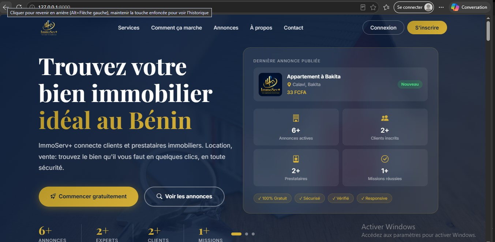
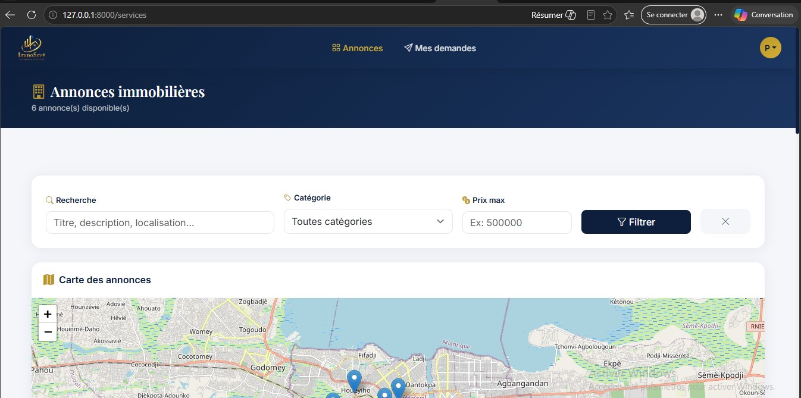
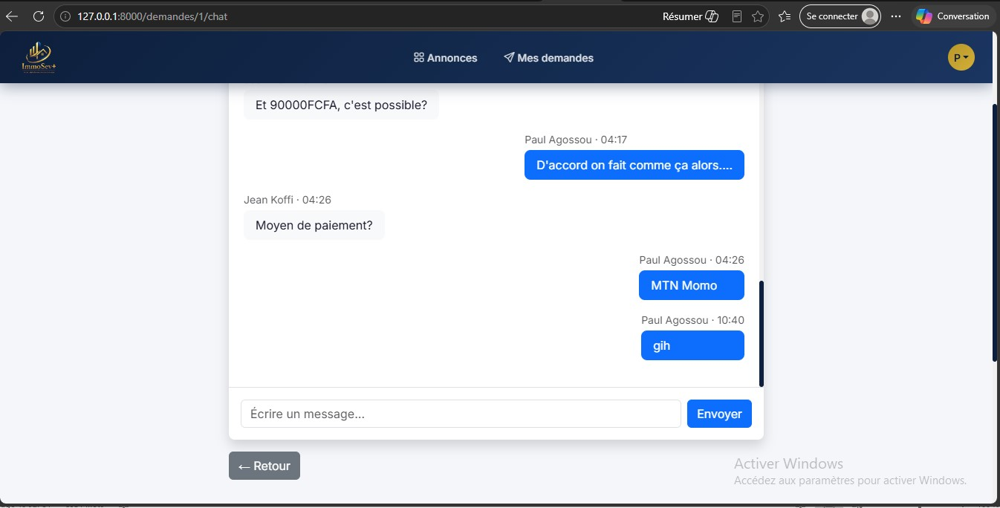
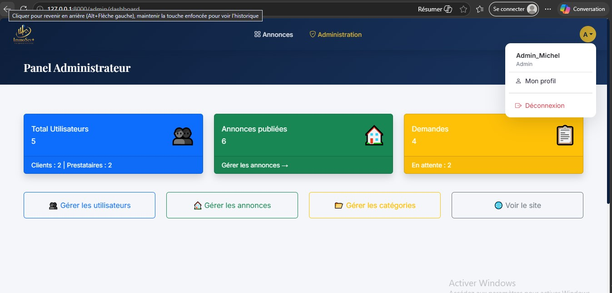

# ImmoServ+

**A web platform connecting clients and real estate service providers in Benin.**
Geolocated listings, real-time messaging, reviews and an admin panel, built with Laravel 12.


## About the project

Benin's real estate market is still largely informal. Finding a home to rent or buy relies on word of mouth, handwritten signs and unreliable intermediaries. The result is wasted time, little price transparency and unequal access to information for everyone involved.

ImmoServ+ centralizes property offers in one place. Clients can search, locate properties on a map and contact providers directly. Providers (agencies and owners) can publish and manage their listings. The platform focuses on **rentals and sales** and is adapted to the local context: French interface, prices in FCFA, and a mobile-first design.

The project was developed as a final-year thesis for a Bachelor's degree in Computer Systems and Software at ESTAG, Cotonou. Its needs analysis is based on field observation during an internship at a real estate agency and on interviews with clients, providers and informal intermediaries.

## Features

### Clients
- Register and log in
- Search listings by keyword, location and price range
- View listings on an interactive map
- Browse listing details: photo gallery, full description, provider information
- Send a contact request and track its status (pending, accepted, refused)
- Chat in real time with a provider once a request is accepted
- Leave a rating and a comment after an accepted request
- Manage a personal profile

### Providers
- Publish rental or sale listings with title, description, price, location, GPS coordinates and multiple photos
- Edit, deactivate or delete listings
- Accept or refuse client requests
- Real-time messaging with clients
- Receive notifications for each new request
- Export listings as PDF
- Manage a personal profile

### Administrators
- Dashboard with global statistics
- User management
- Listing moderation (activate, deactivate, delete)
- Category management

## Tech stack

| Layer | Technologies |
|---|---|
| Presentation | Laravel Blade, Bootstrap 5, Leaflet.js (OpenStreetMap), Pusher.js |
| Business logic | Laravel 12 (PHP 8.2), role-based authentication, Laravel Reverb (WebSockets), queue worker, Vite, DomPDF |
| Data | MySQL 8.x, Eloquent ORM |
| Local environment | XAMPP (Apache, MySQL, phpMyAdmin) |

The application follows an **MVC, 3-tier architecture**: browser, Laravel backend, MySQL database.

## Database

Main tables: `users`, `categories`, `services` (the property listings), `service_images`, `demandes`, `messages`, `avis`, `notifications`.

Some business rules:
- A review can only be submitted if an accepted request exists between that client and that listing. Ratings range from 1 to 5.
- Listings use soft deletion, so the history of requests and reviews is preserved.
- Administrators can permanently delete data. Deleting a user also removes their listings, requests, messages, reviews and notifications (`ON DELETE CASCADE`).

## Security

- Passwords hashed with Bcrypt
- SQL injection protection through Eloquent and prepared statements
- CSRF protection on forms
- Role-based access control (client, provider, administrator)

## Screenshots












## Installation

### Requirements
- PHP 8.2 or higher
- Composer
- Node.js and npm
- MySQL 8.x (for example through XAMPP)

### Steps

```bash
# 1. Clone the repository
git clone https://github.com/MichelgalaxyOne/immoserv-plus.git
cd immoserv-plus

# 2. Install dependencies
composer install
npm install

# 3. Configure the environment
cp .env.example .env
php artisan key:generate
```

Open `.env` and set your MySQL database credentials (the default is SQLite, so change `DB_CONNECTION` and uncomment the other lines) and the Reverb (WebSocket) variables:

```env
DB_CONNECTION=mysql
DB_HOST=127.0.0.1
DB_PORT=3306
DB_DATABASE=your_database_name
DB_USERNAME=root
DB_PASSWORD=

BROADCAST_CONNECTION=reverb

REVERB_APP_ID=local-app-id
REVERB_APP_KEY=local-app-key
REVERB_APP_SECRET=local-app-secret
REVERB_HOST=localhost
REVERB_PORT=8080
REVERB_SCHEME=http

VITE_REVERB_APP_KEY="${REVERB_APP_KEY}"
VITE_REVERB_HOST="${REVERB_HOST}"
VITE_REVERB_PORT="${REVERB_PORT}"
VITE_REVERB_SCHEME="${REVERB_SCHEME}"
```

For local use, the Reverb ID, key and secret can be any values you choose.

Create an empty database with that name in phpMyAdmin, then continue:

```bash
# 4. Create the tables, load the demo data and create the storage link
php artisan migrate --seed
php artisan storage:link

# 5. Start the application (each command in its own terminal)
php artisan serve
php artisan reverb:start
php artisan queue:work
npm run dev
```

The application is then available at `http://127.0.0.1:8000`.

### Demo accounts

The seeder creates demo data (categories, sample listings and requests) and these test accounts:

| Role | Email | Password |
|---|---|---|
| Administrator | admin@immo.com | admin123 |
| Provider | jean@immo.com | password |
| Provider | marie@immo.com | password |
| Client | paul@immo.com | password |
| Client | ines@immo.com | password |

> These accounts are for local testing only. Change or remove them before any real deployment.

## Project status

Functional tests have been carried out on the main features. Possible improvements include online payment, push notifications, advanced search filters and deployment on a production server.

## Author

**Marie-Michel HOUNKPE**
Bachelor's degree in Computer Systems and Software, ESTAG, Cotonou (Benin)
GitHub: [@MichelgalaxyOne](https://github.com/MichelgalaxyOne)
